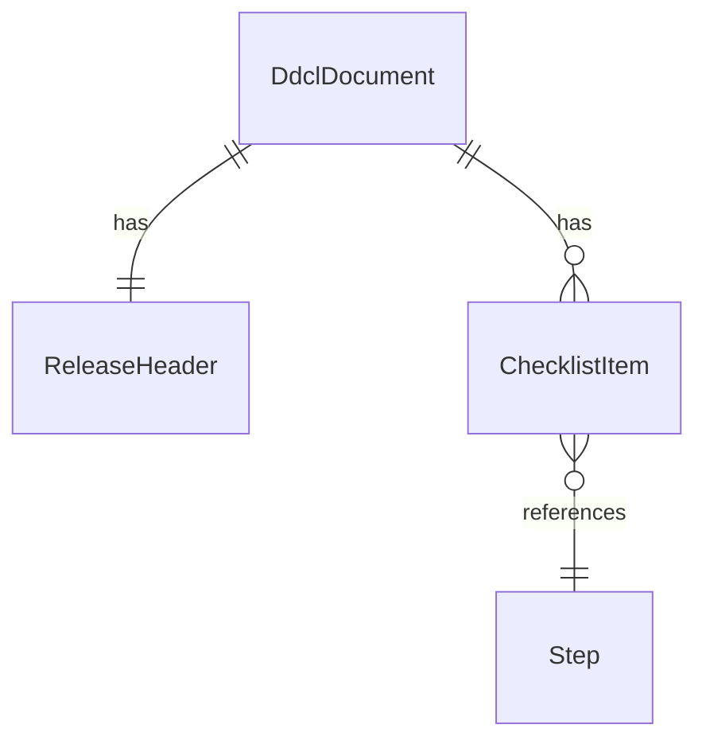

# Functional Design — u1-walking-skeleton — Functional Spec

Sumber: `entities.md`, `rules.md` (sumber kebenaran untuk data & logika keputusan di dokumen ini), `stories.md` (US1.1, US2.1, US2.2, US4.1 — lihat `unit-of-work-story-map.md`), jawaban `functional-design-questions.md` Q7.

Ini adalah sumber kebenaran untuk urutan langkah (workflow) dan transisi status di Unit ini — keduanya tidak tertangkap oleh `entities.md` (bentuk data) atau `rules.md` (logika keputusan).

## Alur Kerja (Workflow)

Satu-satunya alur yang dirancang untuk skeleton ini (jawaban Q7) — urutan yang sama yang dibuktikan oleh Construction Verification Command nanti.

### Alur: Buat step → Susun DDCL → Ekspor Excel

Mengimplementasikan: US1.1 (AC1.1.1, AC1.1.3), US2.1 (header minimal), US2.2 (satu step tersusun), US4.1 (AC4.1.1, AC4.1.2).

1. Pengguna (sesi dev-mode tetap) membuka layar Library dan mengisi nama step serta memilih kategori object/parameter (satu kategori, demo skeleton).
2. Sistem memvalidasi field wajib (BR1.1). Jika kosong, sistem menolak dan menyebutkan field yang kosong; pengguna mengisi ulang dan mencoba lagi.
3. Sistem menyimpan `Step` baru di Library.
4. Pengguna membuka layar penyusunan DDCL dan mengisi field header Release Document (`ReleaseHeader`) — tanpa validasi wajib di skeleton ini (lihat `entities.md`). Label tab yang ditampilkan di layar ini mengikuti tanggal yang diisi (BR1.7).
5. Sistem membuat `DdclDocument` baru: `status` = "Draft" (BR1.2), `createdBy` = `"dev-user"` (BR1.3), beserta `ReleaseHeader` miliknya.
6. Pengguna menambahkan step yang dibuat di langkah 1–3 ke checklist DDCL ini.
7. Sistem membuat satu `ChecklistItem` (`order` = 1) yang merujuk `Step` tersebut, dengan nilai object/parameter yang diisi pengguna.
8. Pengguna mengklik "Unduh Excel".
9. Sistem memuat file template `DDCL BCAS PROD 202611 - TEMPLATE.xlsx` (ADR-005). Jika gagal dimuat, sistem menolak dengan pesan jelas (BR1.4) dan alur berhenti di sini.
10. Sistem memetakan header, satu baris checklist, dan nilai object/parameter apa adanya (BR1.6) ke sel template, lalu mengembalikan file Excel yang dihasilkan ke pengguna.
11. Pengguna membuka file yang diunduh dan membandingkannya dengan tata letak template — ini adalah bukti ujung-ke-ujung yang disyaratkan checkpoint skeleton.

**Kondisi gagal yang dirancang dalam alur ini**: field step kosong (langkah 2), template tidak terbaca (langkah 9), database tidak terjangkau pada langkah manapun yang menulis data (BR1.5 — sistem mengembalikan error generik dan mencatat detail di log server; pengguna mengulang aksi setelah layanan pulih).

**Di luar cakupan alur ini** (lihat Boundaries U1 di `unit-of-work.md`): mengedit DDCL yang sudah dibuat, menghapus step, menambah lebih dari satu baris checklist, rollback, Checklist Capture, perubahan status selain "Draft", versi DDCL, lock, login/multi-akun nyata, dan sanitasi formula-like (AC4.1.5 — itu cakupan u6-excel-export-hardening).

## Model Data (turunan dari `entities.md`)

## Ringkasan Aturan (turunan dari `rules.md`)

| ID | Pernyataan singkat |
|---|---|
| BR1.1 | Nama & kategori step wajib diisi |
| BR1.2 | Status DdclDocument selalu "Draft" saat dibuat |
| BR1.3 | createdBy = stub "dev-user" |
| BR1.4 | Ekspor gagal jelas jika template tidak terbaca |
| BR1.5 | Error generik ke klien saat DB tidak terjangkau |
| BR1.6 | Nilai parameter ditulis apa adanya ke sel |
| BR1.7 | Label tab mengikuti tanggal Release Header |

## Assumptions & Open Questions

None.
