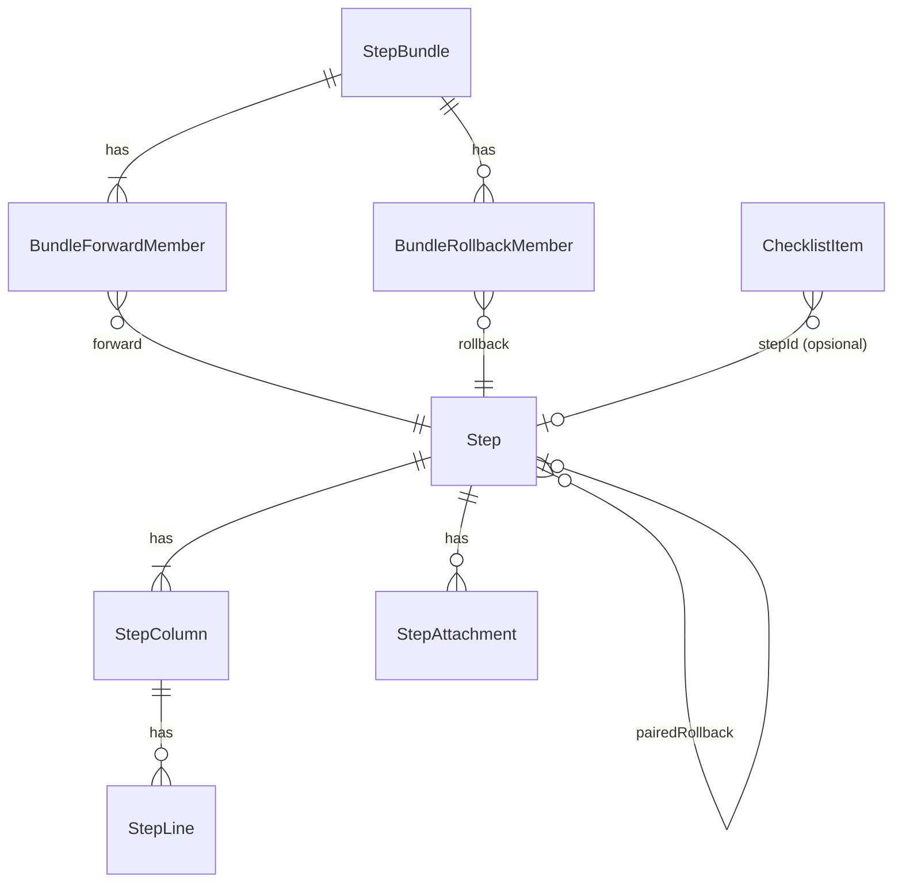

# Functional Design — u2-step-library — Functional Spec

Sumber: `entities.md`, `rules.md` (sumber kebenaran untuk data dan logika keputusan di dokumen ini), `stories.md` (US1.1, US1.2, US1.3 — lihat `unit-of-work-story-map.md`), jawaban `functional-design-questions.md` Q1–Q11.

Ini adalah sumber kebenaran untuk urutan langkah (workflow) di Library Step. Library tidak punya siklus status: sebuah step atau bundle ada atau tidak ada, jadi tidak ada state machine di Unit ini.

## Alur Kerja (Workflow)

### Alur 1: Buat step

Mengimplementasikan: US1.1 (AC1.1.2, AC1.1.3), US1.3 (AC1.3.1). Path dasar buat-step-simpan dibuktikan di U1 (AC1.1.1); pemasangan langsung ke DDCL yang sedang disusun ada di layar komposisi (u3-ddcl-composition).

1. Pengguna membuka layar Library dan memilih "Buat Step Baru". Form menampilkan 3 kolom langkah kosong (BR2.2).
2. Pengguna mengisi judul step, memilih kategori dan jenis (forward atau rollback), lalu menulis langkah di kolom. Tombol "Tambah kolom" dan tombol tambah/hapus langkah tersedia; nomor langkah mengikuti urutan (BR2.2).
3. Pengguna boleh menulis variabel `{nama}` di teks langkah. Layar menampilkan daftar variabel yang terdeteksi dari teks (BR2.4).
4. Pengguna boleh menambah lampiran: nama file dan isi teksnya, ekstensi bebas (BR2.5).
5. Untuk step forward, pengguna memilih step rollback yang sudah ada sebagai pasangan, atau membuat step rollback baru langsung di form yang sama, atau melewatinya (BR2.9). Melewati berarti step tampil dengan penanda Belum ada rollback (BR2.10).
6. Pengguna menyimpan. Sistem memvalidasi (BR2.1, BR2.4, BR2.5, BR2.9). Jika gagal, sistem menolak dan menyebutkan field yang bermasalah; pengguna memperbaiki dan mencoba lagi.
7. Sistem memeriksa nama sama dalam kategori yang sama (BR2.3). Jika sama, sistem menolak dengan 409 dan layar membuka popup yang membandingkan step yang sudah ada (kolom, langkah, lampiran) dengan yang baru diketik. Pilihan: Pakai step yang sudah ada, atau Ubah nama dan simpan lagi.
8. Sistem menyimpan Step beserta kolom, langkah, lampiran, dan pasangan rollback dalam satu transaksi, lalu kembali ke daftar Library dengan step baru terlihat.

**Kondisi gagal yang dirancang**: field wajib kosong atau kurung kurawal tidak berpasangan (langkah 6), nama sama (langkah 7), lampiran tidak sah (langkah 6), database tidak terjangkau (BR1.5 dari U1 berlaku: error generik ke klien, detail di log server).

### Alur 2: Lihat, cari, dan filter Library

Mengimplementasikan: US1.2 (AC1.2.1), US1.3 (AC1.3.2 sisi Library). Aturan: BR2.6, BR2.10, BR2.12, BR2.13.

1. Pengguna membuka layar Library. Sistem menampilkan daftar step; tiap baris memuat nama, kategori, jenis, jumlah DDCL yang memakainya, dan penanda Belum ada rollback bila forward tanpa pasangan.
2. Pengguna mengetik di kolom cari atau memilih kategori di filter. Sistem menyaring di server; hasil kosong ditampilkan sebagai daftar kosong dengan pesan, bukan error.
3. Daftar bundle ditampilkan di bagian terpisah dengan cara cari dan filter yang sama.

### Alur 3: Edit step

Mengimplementasikan: US1.3 (AC1.3.3). Aturan: BR2.1–BR2.5, BR2.8, BR2.9.

1. Pengguna memilih sebuah step dan membuka form yang sama dengan Alur 1, terisi isi saat ini.
2. Pengguna mengubah judul, kolom, langkah, variabel, lampiran, atau pasangan rollback, lalu menyimpan.
3. Sistem memvalidasi seperti Alur 1 (termasuk pemeriksaan nama sama bila nama atau kategori berubah), lalu menyimpan.
4. DDCL yang sudah memakai step ini tidak berubah: setiap item checklist menyimpan snapshot-nya sendiri (BR2.8). Hanya item yang dibuat setelah ini memakai isi baru. Layar mengatakan itu di dekat tombol simpan.

### Alur 4: Hapus step

Mengimplementasikan: US1.2 (AC1.2.2). Aturan: BR2.7, BR2.8.

1. Pengguna memilih Hapus pada sebuah step. Layar menampilkan jumlah DDCL yang memakainya, bundle yang akan ikut terhapus (yang step ini adalah satu-satunya anggota forward-nya), dan step forward yang akan kehilangan pasangan rollback; layar menjelaskan bahwa DDCL yang sudah memakainya tetap utuh.
2. Pengguna mengonfirmasi. Sistem menghapus step beserta kolom, langkah, dan lampirannya; mengosongkan pasangan rollback pada step forward yang menunjuknya; mengeluarkannya dari bundle (bundle yang kehilangan anggota forward terakhir ikut dihapus); dan membuat `stepId` item checklist yang merujuknya menjadi kosong tanpa menyentuh snapshot.
3. Jika step sudah tidak ada saat dihapus (dihapus orang lain lebih dulu), sistem menjawab 404 dan layar menyegarkan daftar.

### Alur 5: Kelola bundle

Mengimplementasikan: kebutuhan bundle dari Q11 (bukan story bernomor; dicatat di Traceability sebagai `reverse`). Aturan: BR2.11, BR2.14. Memasang bundle ke DDCL ada di U3; U2 hanya menyediakan data bundle (BR2.14) yang dibaca U3.

1. Pengguna membuka bagian Bundle di Library dan memilih "Buat Bundle". Ia mengisi nama dan kategori (opsional).
2. Pengguna memilih step forward yang ada dan menyusun urutannya (mis. buka database, masuk database, jalankan query).
3. Pengguna memilih step rollback yang ada dan menyusun urutannya. Jumlahnya boleh berbeda dari jumlah step forward (mis. 2 rollback untuk 3 forward).
4. Sistem memvalidasi (BR2.11) dan menyimpan. Mengedit mengubah daftar anggota dan urutannya; menghapus bundle tidak menghapus step di dalamnya.

**Di luar cakupan alur ini** (lihat Boundaries U2 di `unit-of-work.md`): memasang step atau bundle ke sebuah DDCL, mengisi nilai variabel per DDCL, mengubah lampiran per DDCL, penanda rollback di bagian Rollback & Recovery Plan sebuah DDCL, dan menulis kolom/langkah/lampiran ke file Excel (U3 dan U6). Mengisi nilai variabel dan menambahkan bundle ke DDCL harus dirancang di U3; keputusan itu dicatat di sana.

## Perubahan dan perluasan Kontrak API yang diputuskan di desain ini

Contract 2 (`contract-summary.md`) mendefinisikan `GET/POST /api/v1/steps`, `GET /api/v1/steps/categories`, `PATCH/DELETE /api/v1/steps/{id}`. Desain ini menambah hal berikut dan mengubah satu bentuk respons. Semuanya diberlakukan di Code Generation U2, dan `contract-summary.md` diperbarui di sana:

**Perubahan bentuk (bukan perluasan):** `GET /api/v1/steps/categories` yang di kontrak berbunyi "skema kategori object/parameter per jenis step" kini mengembalikan array `{ "name": string }` untuk empat kategori tanpa daftar isian (BR2.12, keputusan Q10). Code Generation U2 memeriksa dan menyesuaikan setiap pemakai endpoint ini di U1 (frontend dan test) sebelum mengubahnya.

**Perluasan (menambah, tidak mengubah yang ada):**

- Body step (`POST`, `PATCH`) dan respons `GET` membawa `columns` (daftar kolom, masing-masing dengan `label` opsional dan `lines` berurutan), `attachments` (`filename`, `content`), dan `variables` (hasil turunan, hanya dibaca).
- `POST` boleh membawa `rollbackStep` (isi lengkap step rollback baru) untuk membuat pasangan atomik (BR2.9).
- Respons `409` membawa isi lengkap step yang sudah ada dan `conflictOn` (`step` atau `rollbackStep`) (BR2.3). Kunci keunikan 409 kini memuat `kind` selain nama dan kategori.
- `GET /api/v1/bundles/{id}` mengembalikan anggota forward dan rollback berurutan dengan isi lengkap step (BR2.14).
- Respons `PATCH`/`DELETE` step melaporkan dampaknya: bundle yang ikut terhapus dan step forward yang kehilangan pasangan rollback (BR2.7).
- `GET /api/v1/steps` menerima parameter `q` dan `category` (BR2.13). `GET /api/v1/steps/categories` mengembalikan nama kategori saja (BR2.12).
- Endpoint baru `/api/v1/bundles` (GET, POST) dan `/api/v1/bundles/{id}` (PATCH, DELETE) untuk BR2.11.
- `POST /api/v1/ddcls/{id}/checklist-items` (Contract 3, dibangun di U1) menyimpan `stepSnapshot` (BR2.8).

Deviasi yang diputuskan manusia: AC1.1.3 pada `stories.md` menyebut "hanya field yang relevan dengan kategori" yang tampil. Berdasarkan jawaban Q10, kategori tidak membawa daftar isian tetap; isian yang diminta mengikuti variabel di teks langkah. Pembaca di gate perlu tahu AC1.1.3 dipenuhi dengan cara itu.

## Model Data (turunan dari `entities.md`)

## Ringkasan Aturan (turunan dari `rules.md`)

| ID | Pernyataan singkat |
|---|---|
| BR2.1 | Nama, kategori sah, jenis, dan minimal satu langkah wajib |
| BR2.2 | Form baru 3 kolom, kolom bisa ditambah atau dikurangi, minimal satu |
| BR2.3 | Nama sama per kategori ditolak 409, tawarkan step yang ada dengan perbandingan |
| BR2.4 | Variabel {nama} diturunkan dari teks; tanpa daftar isian tetap per kategori |
| BR2.5 | Lampiran teks, nama unik tanpa path, ukuran dibatasi |
| BR2.6 | usageCount dihitung di lapisan endpoint |
| BR2.7 | Hapus step selalu boleh; DDCL lama tidak berubah |
| BR2.8 | Snapshot step saat dipasang; Library tidak menulis ke snapshot |
| BR2.9 | Pasangan rollback hanya forward ke rollback; bisa dibuat inline atomik |
| BR2.10 | Penanda Belum ada rollback di Library |
| BR2.11 | Bundle forward berurutan + rollback berurutan, jumlah boleh beda |
| BR2.12 | Kategori daftar tetap, hanya label |
| BR2.13 | Cari nama dan filter kategori di server |
| BR2.14 | Rollback bundle berdiri sendiri; sumber rollback dan urutannya ditetapkan untuk U3 |

## Assumptions & Open Questions

- [open] BR2.14 menetapkan sumber rollback, urutan, dan bentuk data bundle untuk U3 dari penafsiran jawaban Q11; U3 menanyakan ulang ke pengguna saat Functional Design U3 sebelum membangun pemasangan bundle ke DDCL.
