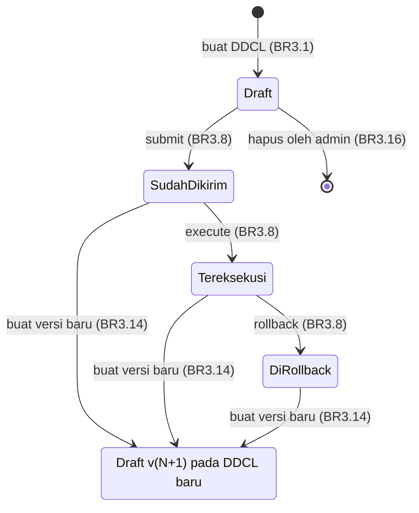
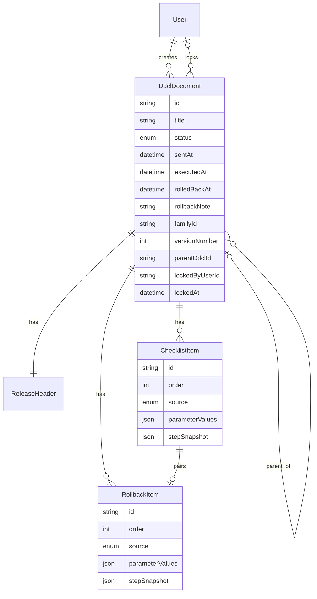

# Functional Design — u3-ddcl-composition — Functional Spec

## Sources

- [memory] `entities.md` dan `rules.md` (sumber kebenaran data dan logika keputusan; dokumen ini hanya merangkai urutan langkah dan mengacu BR3.x).
- [memory] `stories.md` US2.1–US2.4, US3.1, US3.2, US6.1 (lihat `unit-of-work-story-map.md`); `requirements.md` FR1, FR3–FR6, FR10, FR10.1.
- [Q1–Q13] jawaban `functional-design-questions.md`.

Unit ini punya siklus status, jadi ada state machine di bawah. Tampilan di layar dibangun di Code Generation U3; dokumen ini menetapkan perilakunya.

## Alur Kerja (Workflow)

### Alur 1: Buat DDCL dan isi header

Mengimplementasikan: US2.1 (AC2.1.1, AC2.1.2). Aturan: BR3.1, BR3.9, BR3.17.

1. Pengguna (editor atau admin) memilih Buat DDCL baru dan mengisi judul serta tujuh field header; Technical Change boleh kosong.
2. Pengguna menyimpan. Sistem memvalidasi (BR3.1). Jika ada field wajib kosong, sistem menolak 400, layar menyebut semua field yang kosong sekaligus, dan semua isian tetap di layar.
3. Sistem membuat DDCL berstatus Draft, mengaitkan pembuat, dan langsung mengunci untuk pembuat (BR3.9). Layar membuka mode edit.
4. Mengubah header sesudahnya memakai aturan yang sama; field wajib tidak bisa dikosongkan (BR3.1).

**Kondisi gagal yang dirancang**: field wajib kosong atau tanggal tidak sah (langkah 2), database tidak terjangkau (BR1.5 U1: error generik ke klien, detail di log server).

### Alur 2: Susun checklist (tambah, urutkan, duplikasi, isi, hapus)

Mengimplementasikan: US2.2 (AC2.2.1–AC2.2.3). Aturan: BR3.2–BR3.5, BR3.10, BR3.11.

1. Pengguna membuka DDCL Draft dalam mode edit (lock dipegang, BR3.9) dan memilih step dari Library.
2. Sistem menyimpan snapshot step (BR2.8) sebagai baris checklist pada posisi yang dipilih dan, bila step punya pasangan rollback, menambah baris rollback (Alur 3). Layar menampilkan kolom isian dari variabel `{nama}` di teks langkah (BR3.2, BR3.4).
3. Pengguna mengisi nilai variabel; sistem menyimpan nilai terpisah dari snapshot (BR3.4).
4. Pengguna memindahkan baris atau menekan Duplikasi; sistem menata ulang posisi atau membuat baris terpisah di bawahnya beserta rollback pasangan sendiri (BR3.3, BR3.5).
5. Pengguna menghapus baris; sistem menghapus rollback pasangannya dan merapatkan posisi (BR3.3, BR3.12).
6. Setiap simpan memperpanjang lock; layar yang terbuka juga memperpanjang tiap 5 menit (BR3.9).

**Kondisi gagal yang dirancang**: lock habis atau diambil orang lain di tengah simpan (BR3.10: 409, layar mengambil lock lagi bila bisa dan mengulang, isian tetap), step sudah dihapus dari Library (404), posisi tidak sah (400), variabel tidak dikenal (400).

### Alur 3: Rollback & Recovery Plan

Mengimplementasikan: US2.3 (AC2.3.1); sisi U2 AC1.3.2. Aturan: BR3.2, BR3.6, BR3.12, BR3.3.

1. Saat step forward bersama pasangan rollback masuk ke checklist, sistem menambah baris rollback di akhir daftar rollback (BR3.2). Step tanpa pasangan tampil dengan penanda Belum ada rollback (BR3.6).
2. Saat bundle dipasang (Alur 4), rangkaian rollback bundle ditambahkan di akhir sesuai urutan tersimpan di bundle (BR3.6).
3. Pengguna mengatur urutan rollback sendiri, terpisah dari checklist, dan boleh mengisi nilai atau menghapus baris rollback (BR3.12). Mengurutkan checklist tidak mengubah urutan rollback.

### Alur 4: Pasang bundle

Mengimplementasikan: US2.2 (AC2.2.1), US2.3 (AC2.3.1); aturan data dari U2 BR2.14. Aturan: BR3.6.

1. Pengguna memilih bundle dari Library dan posisi penempatan.
2. Sistem membaca bundle, menambah semua step forward anggotanya berurutan sebagai baris checklist, masing-masing dengan snapshot sendiri, dan menambah rangkaian rollback bundle (BR3.6). Pasangan rollback per step anggota tidak dipasang tambahan.
3. Jika rangkaian rollback bundle kosong, layar memberi tahu pengguna (respons `bundleHasNoRollback`).

**Kondisi gagal yang dirancang**: bundle sudah dihapus (404, tidak ada yang terpasang).

### Alur 5: Checklist Capture

Mengimplementasikan: US2.4 (AC2.4.1, ditunda sebagian). Aturan: BR3.13.

1. Pengguna membuka bagian Checklist Capture. Layar menampilkan tabel kosong berkolom Step, Actual Time, Capture Before, Capture After, mengikuti template.
2. Tidak ada isian yang disimpan di v1 dan tabel tidak menghalangi langkah lain.

### Alur 6: Lock edit dan mode baca

Mengimplementasikan: US6.1 (AC6.1.1, AC6.1.2). Aturan: BR3.9, BR3.10.

1. Pengguna membuka DDCL Draft. Jika orang lain memegang lock aktif, layar menampilkan mode baca dengan pemberitahuan siapa yang mengedit dan sampai kapan (AC6.1.1). Jika tidak, pengguna bisa menekan Edit untuk mengambil lock.
2. Selama mengedit, layar memperpanjang lock tiap 5 menit dan setiap simpan memperpanjangnya.
3. Pengguna menutup dengan benar: layar melepas lock (DELETE lock). Pengguna menutup tab atau kehilangan sambungan: tidak ada perpanjangan, lock dianggap lepas setelah 15 menit dan orang lain bisa mengambilnya (AC6.1.2).
4. Pengambilan lock oleh dua orang bersamaan diselesaikan oleh UPDATE bersyarat atomik: satu berhasil, satu mendapat 409 (BR3.9).

### Alur 7: Kirim, eksekusi, rollback, dan ubah tanggal

Mengimplementasikan: US3.1 (AC3.1.1). Aturan: BR3.7, BR3.8, BR3.11.

1. Pengguna menekan Tandai Sudah Dikirim pada DDCL Draft. Sistem memeriksa lock dan kelengkapan header (BR3.1), mengisi tanggal kirim dengan waktu sekarang (boleh diubah di layar sebelum konfirmasi), mengubah status, dan melepas lock. DDCL menjadi read-only (BR3.11).
2. Pengguna menekan Tandai Tereksekusi pada DDCL Sudah Dikirim; tanggal eksekusi terisi otomatis dan boleh diubah (BR3.8, BR3.7).
3. Jika perlu mundur, pengguna menekan Tandai Rollback pada DDCL Tereksekusi, mengisi tanggal (otomatis, boleh diubah) dan catatan singkat opsional; status menjadi Di-rollback dan tidak berubah lagi (BR3.8).
4. Kapan saja setelah dikirim pengguna bisa memperbaiki tanggal lewat PATCH dates; urutan kirim, eksekusi, rollback dijaga (BR3.7).

**Kondisi gagal yang dirancang**: tombol ditekan pada status yang salah atau dua orang menekan bersamaan (409, status saat ini ditampilkan), urutan tanggal bertentangan (400), header tidak lengkap saat kirim (400 dengan daftar field).

### Alur 8: Buat versi baru

Mengimplementasikan: US3.2 (AC3.2.1, AC3.2.2). Aturan: BR3.14, BR3.15.

1. Pada DDCL Sudah Dikirim, Tereksekusi, atau Di-rollback pengguna menekan Buat Versi Baru.
2. Sistem membuat "<judul asli> v<N>" berstatus Draft, terhubung ke DDCL asal, dengan salinan header, checklist (snapshot dan nilai apa adanya), dan rollback; pembuat langsung memegang lock (BR3.14).
3. Jika sudah ada versi yang lebih baru, sistem menjawab 409 dengan tautan ke versi terbaru. Layar rekap dan detail menampilkan dropdown dari versi pertama sampai terakhir (BR3.15).

### Alur 9: Hapus DDCL Draft

Mengimplementasikan: keputusan Q9. Aturan: BR3.16, BR3.17.

1. Admin memilih Hapus pada DDCL Draft; layar meminta konfirmasi yang menyebut judul.
2. Sistem menghapus DDCL beserta isinya. DDCL yang sudah dikirim tidak bisa dihapus (403); DDCL yang sedang dikunci orang lain mendapat 409.

## State Machine Status DDCL

Teks pengganti: Draft menuju Sudah Dikirim (submit), menuju Tereksekusi (execute), menuju Di-rollback (rollback), searah. DDCL Draft bisa dihapus admin. Dari Sudah Dikirim, Tereksekusi, atau Di-rollback bisa dibuat DDCL baru berstatus Draft (versi N+1); DDCL asal tidak berubah status.

| Dari | Aksi | Ke | Syarat |
|---|---|---|---|
| Draft | submit | Sudah Dikirim | lock dipegang, header lengkap (BR3.1, BR3.10) |
| Sudah Dikirim | execute | Tereksekusi | tanggal berurutan (BR3.7) |
| Tereksekusi | rollback | Di-rollback | tanggal berurutan, catatan opsional (BR3.7) |
| Draft | hapus | (hilang) | admin, tidak dikunci orang lain (BR3.16) |
| Sudah Dikirim, Tereksekusi, Di-rollback | buat versi baru | DDCL baru Draft | versi terbaru keluarga (BR3.14) |

## Diagram ER Turunan

## Ringkasan Aturan (turunan dari `rules.md`)

| Aturan | Isi singkat |
|---|---|
| BR3.1 | Header wajib kecuali Technical Change; semua field kosong disebut sekaligus |
| BR3.2 | Tambah step: snapshot, pasangan rollback otomatis |
| BR3.3 | Posisi rapat; urutan checklist dan rollback saling bebas |
| BR3.4 | Nilai isian hanya untuk variabel yang ada di step |
| BR3.5 | Duplikasi baris beserta rollback pasangan sendiri |
| BR3.6 | Bundle: rangkaian rollback bundle sesuai urutan tersimpan |
| BR3.7 | Tanggal status otomatis, boleh diubah, berurutan |
| BR3.8 | Status searah: Draft, Sudah Dikirim, Tereksekusi, Di-rollback |
| BR3.9 | Lock 15 menit, perpanjangan, pengambilan atomik |
| BR3.10 | Tulis butuh Draft dan lock aktif, diperiksa dalam transaksi |
| BR3.11 | Read-only setelah dikirim |
| BR3.12 | Baris rollback diurutkan, diisi, dihapus sendiri |
| BR3.13 | Capture: tabel kosong, tanpa data |
| BR3.14 | Versi baru: Draft, salinan, nama "<judul asli> vN" |
| BR3.15 | Daftar: satu baris per DDCL asli dengan dropdown versi |
| BR3.16 | Hapus: admin, hanya Draft |
| BR3.17 | Peta role rute U3 |
| BR3.18 | Migrasi data DDCL lama: familyId, versionNumber, sentAt |

## Assumptions & Open Questions

- [assumption] Lihat `rules.md` bagian Assumptions & Open Questions: versi baru dari Di-rollback, tanggal berupa tanggal dan jam, urutan tanggal, perpanjangan lock tiap 5 menit, lock langsung dipegang pembuat, dan penamaan versi.
- Pembaruan `requirements.md`, `unit-of-work.md`, dan `stories.md` untuk dua status baru belum dilakukan dan butuh persetujuan orang.
