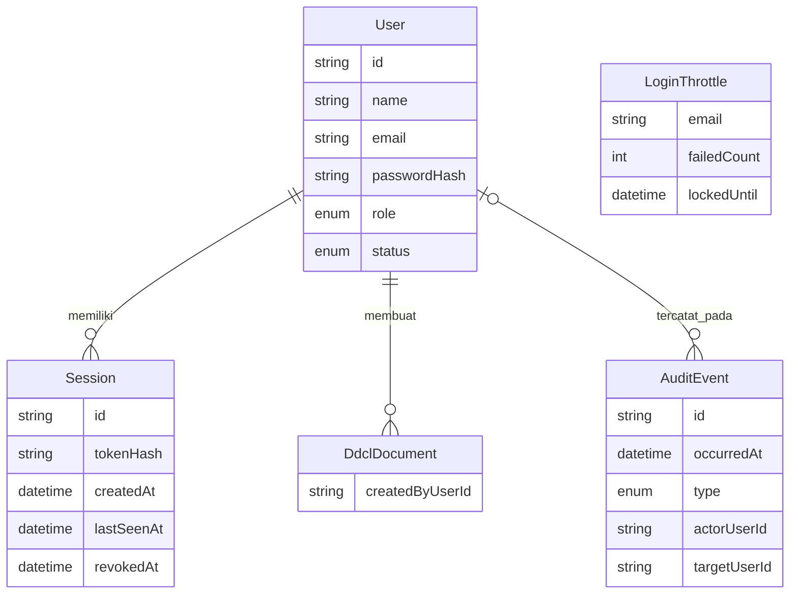

# Functional Design — u4-user-accounts — Functional Spec

Unit ini mengimplementasikan **US6.2** (`stories.md`, AC6.2.1) dan menegakkan NFR2. Sumber: `unit-of-work.md`, `requirements.md` (FR9, NFR2), `contract-summary.md` (Contract 1), `entities.md` dan `rules.md` unit ini, jawaban `functional-design-questions.md` Q1–Q14 (Q12–Q14 dari putaran revisi setelah NFR Requirements).

Dokumen ini adalah sumber kebenaran untuk alur kerja dan mesin status. Diagram ER dan ringkasan aturan di bawah adalah tampilan turunan; sumber kebenarannya `entities.md` dan `rules.md`.

## Ruang lingkup dan deviasi

- Dalam scope: entitas User penuh, login/logout/sesi, penegakan sesi di semua endpoint U1–U3 (dan otomatis U5/U6), tiga role, layar Login, Akun, dan Audit, ganti kata sandi sendiri, pengaturan ulang kata sandi dan pembukaan kunci oleh admin, catatan audit, migrasi pembuat DDCL.
- **Deviasi dari `requirements.md` (diputuskan manusia, Q1, Q9):** role admin/editor/viewer masuk U4. Kepemilikan per-DDCL, SSO, pendaftaran terbuka, dan reset kata sandi lewat email tetap di luar scope v1. Mengaktifkan kembali akun nonaktif tidak ada di layar atau API; dilakukan lewat skrip pemulihan di server (dirancang di NFR Requirements). Deviasi dan penyelarasan AC6.2.1 ("seluruh fitur" berarti sesuai role: viewer hanya membaca) harus dicatat di `requirements.md`, `unit-of-work.md`, dan `stories.md` sebagai pembaruan upstream (review R-03); pembaruan itu dikerjakan sebagai langkah terpisah yang meminta persetujuan Anda karena menyentuh artefak Inception yang sudah disetujui, dan sampai itu selesai `functional-spec.md` ini adalah catatan deviasinya.
- **Perubahan kontrak untuk Code Generation:** Contract 1 menambah `role` pada objek `user` (login dan `/auth/me`), dan menambah endpoint `POST /api/v1/auth/password`, `GET/POST /api/v1/users`, `PATCH /api/v1/users/{id}`, `POST /api/v1/users/{id}/password`, `POST /api/v1/users/{id}/unlock`, dan `GET /api/v1/audit-events`. Respons `401`, `403`, dan `429` ditambahkan pada Contract 2 sampai 5 (semua endpoint U1–U3 sekarang mewajibkan sesi dan role, review R-04). `contract-summary.md` diperbarui saat Code Generation, seperti yang dilakukan U2.

## Diagram ER (turunan dari entities.md)

Teks pengganti: User memiliki nol atau banyak Session dan membuat nol atau banyak DdclDocument; AuditEvent menunjuk User sebagai pelaku atau sasaran bila ada; LoginThrottle berdiri sendiri, dikunci per email.

## Matriks hak (BR4.9)

| Aksi | viewer | editor | admin |
|---|---|---|---|
| Lihat Library, DDCL, riwayat, rekap | ya | ya | ya |
| Ekspor Excel | ya | ya | ya |
| Buat/ubah step, bundle, DDCL; pasang step; tandai Sudah Dikirim; versi baru; lock edit | tidak | ya | ya |
| Hapus atau arsip step, bundle, DDCL | tidak | tidak | ya |
| Kelola akun (daftar, buat, ubah role, nonaktifkan, atur ulang kata sandi akun lain, buka kunci login) | tidak | tidak | ya |
| Lihat catatan audit | tidak | tidak | ya |
| Lihat diri sendiri, logout, ganti kata sandi sendiri | ya | ya | ya |

### Role minimal rute U1–U3 yang sudah ada (BR4.9, review R-04)

| Rute | Role minimal |
|---|---|
| `GET` apa pun di `/api/v1/steps`, `/steps/categories`, `/bundles`, `/ddcls` dan turunannya (daftar, detail, riwayat), `GET /ddcls/{id}/export` | viewer |
| `POST /steps`, `POST /bundles`, `POST /ddcls`, `POST /ddcls/{id}/checklist-items`, dan semua `PATCH`/`PUT` pada Library dan DDCL | editor |
| Semua `DELETE` pada Library dan DDCL (step, bundle, DDCL, checklist item) | admin |
| `GET /health`, `POST /auth/login`, preflight `OPTIONS` | tanpa sesi |
| `GET /auth/me`, `POST /auth/logout`, `POST /auth/password` | viewer (semua role) |
| `GET/POST /users`, `PATCH /users/{id}`, `POST /users/{id}/password`, `POST /users/{id}/unlock`, `GET /audit-events` | admin |

Code Generation mendaftar setiap rute nyata di backend dan mencocokkannya dengan tabel ini; rute yang belum terdaftar bernilai admin (BR4.9).

## Alur kerja

### W1. Bootstrap admin pertama (BR4.11, BR4.16)

1. Backend start dan menjalankan migrasi skema.
2. Bila tabel User kosong dan `ADMIN_EMAIL`/`ADMIN_PASSWORD` sah, buat User admin aktif dalam satu transaksi; bila variabel tidak ada atau tidak sah, backend gagal start dengan pesan jelas.
3. Bila tabel User sudah berisi, variabel diabaikan.
4. Jalankan migrasi pembuat DDCL: isi `createdByUserId` semua DDCL lama dengan admin pertama, lalu jadikan kolom wajib dengan foreign key.
5. Backend mulai menerima permintaan.

### W2. Login (BR4.1–BR4.5)

1. Layar Login mengirim email dan kata sandi ke `POST /api/v1/auth/login`.
2. Backend memeriksa pemeriksaan Origin (BR4.15), lalu menormalisasi email.
3. Bila LoginThrottle email terkunci: jawab `429` generik dengan `Retry-After`, tanpa memeriksa kata sandi.
4. Cari User; hitung hash kata sandi (hash tiruan bila email tidak terdaftar) dan bandingkan.
5. Gagal (email tak terdaftar, kata sandi salah, atau akun nonaktif): naikkan failedCount, kunci 15 menit pada kegagalan ke-5, jawab `401` generik.
6. Berhasil: kosongkan LoginThrottle, cabut sesi lama bila permintaan membawa sesi valid, buat Session (token acak, simpan hash), isi lastLoginAt, set cookie `ddcl_session`, jawab `200` dengan `sessionToken` dan `user` (id, name, email, role).
7. Setiap hasil (berhasil, gagal, terkunci) dicatat sebagai AuditEvent (BR4.20).
8. Frontend menyimpan identitas dari respons dan membuka halaman utama.

### W3. Setiap permintaan ke /api/v1/* (BR4.6, BR4.8, BR4.9, BR4.15)

1. Pengecualian: `POST /auth/login`, `/health`, dan preflight `OPTIONS` tidak butuh sesi (preflight hanya dijawab header CORS).
2. Baca token: header `Authorization: Bearer` bila ada, bila tidak cookie `ddcl_session` (BR4.5, BR4.6).
3. Untuk rute tulis yang diautentikasi lewat cookie atau tanpa sesi, periksa Origin terhadap `ALLOWED_ORIGINS`; tidak cocok → `403`. Permintaan lewat Bearer melewati pemeriksaan ini (BR4.15).
4. Hitung hash token, cari Session; periksa belum dicabut, belum lewat 8 jam diam, belum lewat 7 hari, dan User berstatus aktif. Tidak valid → `401`.
5. Geser `lastSeenAt` (paling cepat sekali per menit per sesi).
6. Bandingkan role User dengan role minimal rute (tabel di atas); kurang → `403`.
7. Jalankan rute dengan identitas pengguna dari sesi.

### W4. Logout (BR4.7)

1. `POST /api/v1/auth/logout` dengan sesi valid mencabut Session itu dan menghapus cookie, jawab `204`.
2. Tanpa sesi valid jawab `401`. Frontend menuju layar Login pada kedua kasus.

### W5. Admin menambah akun (BR4.10)

1. Admin membuka layar Akun dan mengisi nama, email, role, dan kata sandi awal.
2. `POST /api/v1/users` memvalidasi (BR4.1, BR4.2, role sah) dan membuat User aktif; `201` tanpa hash.
3. Email ganda → `409`; data tak sah → `400` dengan field yang bermasalah.
4. Admin menyampaikan kata sandi awal ke pemilik akun di luar portal; pemilik bisa menggantinya (W6).

### W6. Ganti kata sandi sendiri (BR4.12)

1. Pengguna mengisi kata sandi lama dan baru di layar Ganti Kata Sandi.
2. `POST /api/v1/auth/password` memeriksa kunci LoginThrottle email pengguna (terkunci → `429`), lalu memverifikasi kata sandi lama dan memvalidasi yang baru.
3. Kata sandi lama salah: dihitung ke LoginThrottle (5 salah beruntun mengunci 15 menit), `400` generik.
4. Berhasil: simpan hash baru, cabut semua sesi lain pengguna itu, catat AuditEvent, `204`. Sesi yang sedang dipakai tetap hidup.

### W7. Admin menonaktifkan akun (BR4.13)

1. Admin menekan Nonaktifkan pada baris akun lain.
2. `PATCH /api/v1/users/{id}` dengan `status: inactive`. Target dirinya sendiri atau admin aktif terakhir → `409`. Aturan kasus tepi PATCH (404, idempoten, `status: active` → `409`, perubahan ganda atomik) ada di BR4.19.
3. Berhasil: status inactive dan semua sesi akun itu dicabut saat itu juga; permintaan berikutnya dari akun itu `401`.

### W8. Admin mengubah role (BR4.14)

1. Admin memilih role baru pada baris akun.
2. `PATCH /api/v1/users/{id}` dengan `role`. Menurunkan admin aktif terakhir → `409`.
3. Berhasil: role baru berlaku pada permintaan berikutnya akun itu.

### W10. Admin mengatur ulang kata sandi atau membuka kunci (BR4.18)

1. Pada baris akun, admin memilih Atur ulang kata sandi (mengetik kata sandi baru) atau Buka kunci login.
2. `POST /api/v1/users/{id}/password`: validasi BR4.2, simpan hash baru, cabut semua sesi akun itu, kosongkan LoginThrottle emailnya, `204`. `POST /api/v1/users/{id}/unlock`: kosongkan LoginThrottle, `204`.
3. Akun tidak ada → `404`; kata sandi tidak sah → `400`; bukan admin → `403`. Keduanya dicatat sebagai AuditEvent tanpa kata sandi.
4. Admin menyampaikan kata sandi baru ke pemilik di luar portal; pemilik bisa menggantinya (W6).

### W11. Admin melihat catatan audit (BR4.20)

1. Admin membuka layar Audit.
2. `GET /api/v1/audit-events` mengembalikan peristiwa terbaru lebih dulu dengan filter jenis dan rentang tanggal serta pembagian halaman; hanya baca.
3. Non-admin mendapat `403`. Entri lebih tua dari 1 tahun sudah dihapus otomatis.

### W9. Pencabutan stub dev-mode (BR4.8)

1. Hook sesi global menggantikan hook dev-mode U1 di semua rute `/api/v1/*`.
2. Cookie lama `dev-session` tidak lagi dikenali dan menghasilkan `401`.
3. Test U1–U3 memakai helper login (akun uji per role) dan seluruh suite U1–U3 dijalankan ulang sebagai regresi (titik integrasi yang dicatat di `unit-of-work.md`).

## Mesin status

### User.status

| Dari | Peristiwa | Ke | Syarat |
|---|---|---|---|
| (baru) | Akun dibuat (BR4.10/BR4.11) | active | Validasi lolos |
| active | Admin menonaktifkan (BR4.13) | inactive | Bukan diri sendiri; bukan admin aktif terakhir |
| inactive | Skrip pemulihan di server (bukan layar atau API) | active | Dirancang di NFR Requirements; dicatat di log |

### Session

| Dari | Peristiwa | Ke | Syarat |
|---|---|---|---|
| (baru) | Login berhasil | active | BR4.3 |
| active | Logout; akun dinonaktifkan; kata sandi diganti (sesi lain) | revoked | BR4.7, BR4.13, BR4.12 |
| active | Diam >8 jam atau umur >7 hari | expired (dinilai saat dipakai, tidak hidup kembali) | BR4.6 |

### LoginThrottle (per email)

| Dari | Peristiwa | Ke | Syarat |
|---|---|---|---|
| open | Login gagal, failedCount <5 | open (failedCount+1) | BR4.4 |
| open | Login gagal ke-5 | locked (15 menit, failedCount 0) | BR4.4 |
| locked | Waktu kunci habis | open | Otomatis |
| locked | Admin membuka kunci atau mengatur ulang kata sandi (BR4.18) | open (dikosongkan) | Hanya admin |
| open | Kata sandi lama salah pada ganti kata sandi | open (failedCount+1), dan locked pada ke-5 | BR4.4, BR4.12 |
| open | Login berhasil | open (dikosongkan) | BR4.3 |

## Layar frontend (tingkat perilaku)

- **Login**: field email dan kata sandi; pesan kegagalan generik (`401`) dan pesan "terlalu banyak percobaan, coba lagi nanti" (`429`); tidak ada tautan daftar. Setelah berhasil membuka halaman yang diminta semula atau halaman utama.
- **Penjaga rute**: semua halaman selain Login menanyakan `GET /auth/me` saat dibuka; `401` di panggilan API mana pun mengarahkan ke Login.
- **Menu berdasarkan role**: tombol tulis disembunyikan untuk viewer; tombol hapus/arsip hanya untuk admin; menu Akun hanya untuk admin. Menyembunyikan tombol hanya kenyamanan; penegakan ada di backend (BR4.9).
- **Akun (admin)**: tabel akun (nama, email, role, status, login terakhir), form tambah akun, ubah role, tombol Nonaktifkan dengan konfirmasi, Atur ulang kata sandi (isian kata sandi baru), dan Buka kunci login; pesan jelas bila ditolak `409`.
- **Audit (admin)**: daftar hanya-baca peristiwa akun, terbaru lebih dulu, dengan filter jenis dan tanggal serta pembagian halaman.
- **Ganti kata sandi**: tersedia untuk semua role dari menu pengguna; menampilkan batas minimal 10 karakter.

## Penanganan galat dan kasus tepi

| Situasi | Perilaku |
|---|---|
| Dua admin menonaktifkan/menurunkan satu sama lain bersamaan sehingga tak ada admin tersisa | Pemeriksaan dalam transaksi dengan penguncian baris; salah satu ditolak `409` (BR4.13, BR4.14) |
| Dua instance backend start bersamaan dengan tabel kosong | Hanya satu admin terbentuk (transaksi dengan pengecekan kosong, BR4.11) |
| Admin menonaktifkan akun yang sedang memakai portal | Permintaan berikutnya akun itu `401`; layar mengarah ke Login |
| Role diturunkan saat pengguna sedang mengedit | Permintaan tulis berikutnya `403`; layar menampilkan pesan dan mode baca |
| Brute force pada email yang tidak terdaftar | Dikunci sama seperti email terdaftar; pesan sama (BR4.3, BR4.4) |
| Permintaan tulis dari situs lain membawa cookie | Origin tidak cocok → `403` (BR4.15) |
| Migrasi `createdByUserId` gagal | Seluruh migrasi dibatalkan dan backend tidak start (BR4.16) |
| Cookie `dev-session` lama masih ada di browser | `401`, pengguna login ulang (BR4.8) |
| Kata sandi mengandung karakter non-ASCII atau spasi | Diterima apa adanya; panjang dihitung dalam karakter |
| Preflight CORS (OPTIONS) dari frontend | Tidak butuh sesi; dijawab header CORS tanpa data, supaya semua penulisan lintas-origin tidak gagal `401` (BR4.8) |
| Permintaan membawa cookie dan Bearer sekaligus | Bearer dipakai (BR4.6); pemeriksaan Origin dilewati karena diautentikasi lewat Bearer (BR4.15) |
| Pencurian sesi lalu tebak kata sandi lama | Dihitung ke LoginThrottle, kunci 15 menit pada percobaan ke-5 (BR4.12) |
| Admin satu-satunya terkunci login | Admin lain atau skrip pemulihan di server membuka kunci (BR4.18) |
| PATCH akun tidak ada, kosong, atau berulang | 404, 400, atau no-op idempoten 200 (BR4.19) |
| Pencatatan AuditEvent gagal pada perubahan akun | Perubahan dibatalkan; kegagalan mencatat login gagal tidak mengubah jawaban 401 (BR4.20) |

## Ringkasan aturan (turunan dari rules.md)

Aturan BR4.1–BR4.20 mencakup: identitas email (BR4.1), kata sandi (BR4.2), login dan penguncian (BR4.3, BR4.4), sesi (BR4.5–BR4.7), penegakan dan role (BR4.8, BR4.9), kelola akun (BR4.10–BR4.14, BR4.18, BR4.19), perlindungan CSRF (BR4.15), pembuat DDCL (BR4.16), privasi data akun (BR4.17), dan catatan audit (BR4.20). Teks lengkap hanya di `rules.md`.

## Catatan untuk tahap berikutnya

- **NFR Requirements** (jawaban sudah ada, dilanjutkan setelah tahap ini): parameter scrypt dan batas hash bersamaan, retensi dan pembersihan Session, LoginThrottle, dan AuditEvent (1 tahun), skrip pemulihan di server (termasuk mengaktifkan kembali akun dan menjadikan akun admin), cadangan pra-migrasi, dan konfigurasi `COOKIE_SECURE` dan `ALLOWED_ORIGINS`.
- **Unit lain**: U3 (lock, status) dan U5 (kolom pembuat) mengikuti matriks BR4.9 dan memakai `createdByUserId`; U3/U5/U6 mendeklarasikan role minimal tiap rute baru.
