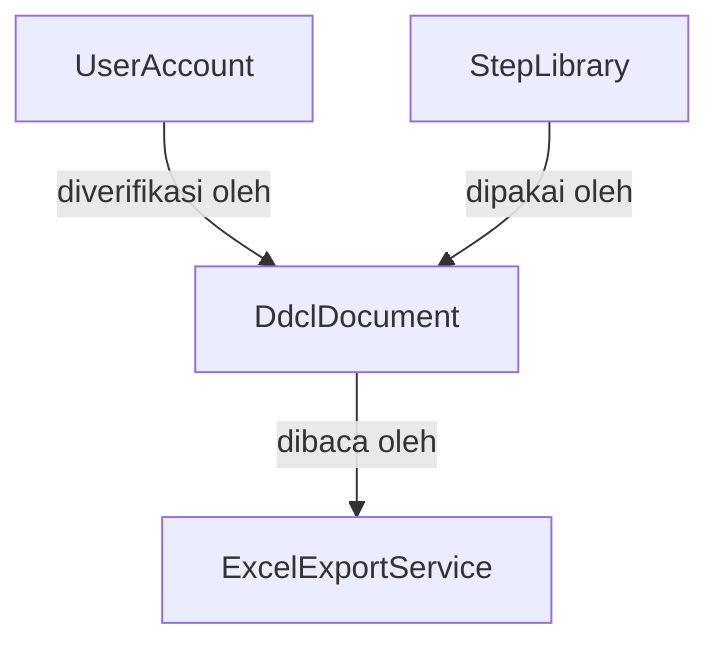

# Domain Design — Component Catalogue

Sumber: `requirements.md` (FR1–FR10, NFR1–NFR6), `stories.md` (US1.1–US6.2), `team-practices.md` (backend/frontend terpisah, PostgreSQL). Keputusan di bawah mengikuti jawaban di `domain-design-questions.md` (Q1–Q4).

## Part A — Machine-Readable Catalogue

```yaml
components:
  - name: UserAccount
    summary: Akun pengguna, identitas, dan sesi login.
    behaviour: >
      Mengelola pendaftaran/keberadaan akun, verifikasi kredensial saat login,
      dan sesi aktif. Setiap endpoint API mewajibkan sesi login yang valid
      (NFR2) — komponen ini adalah sumber kebenaran untuk siapa yang sedang
      login, dipakai DdclDocument untuk mencatat pembuat dan pemegang lock.
    responsibilities:
      - Registrasi dan penyimpanan akun pengguna (FR9)
      - Autentikasi (login/logout) dan manajemen sesi
      - Menyediakan identitas pengguna aktif ke komponen lain
    depends_on: []
    dependents:
      - component: DdclDocument
        interaction: Verifikasi identitas pengguna aktif untuk mencatat pembuat DDCL dan pemegang lock saat diedit (FR10)
    external_dependencies:
      - name: PostgreSQL
        kind: database
        purpose: Penyimpanan akun pengguna dan kredensial (hash)
    entities:
      - name: User
        identifier: id
        attributes: [email, passwordHash, name, createdAt]

  - name: StepLibrary
    summary: Step reusable (forward & rollback), kategori object/parameter, dan pasangan rollback-nya.
    behaviour: >
      Menyimpan step sebagai aset reusable dengan kategori yang menentukan
      field object/parameter yang relevan (FR2.1). Setiap step forward
      menyimpan referensi ke step rollback pasangannya (FR4). Step tetap bisa
      dihapus meski masih dipakai DDCL lama (FR2.4) — penghapusan hanya
      menghilangkan step dari pilihan DDCL baru, tidak menyentuh data yang
      sudah dipakai (snapshot ada di sisi DdclDocument.ChecklistItem/RollbackItem,
      bukan di komponen ini). Jumlah DDCL yang memakai sebuah step (FR2.3)
      TIDAK dihitung oleh komponen ini memanggil DdclDocument — itu akan
      membuat siklus StepLibrary <-> DdclDocument. Penggabungan jumlah
      pemakaian dilakukan di lapisan API yang memanggil kedua komponen secara
      terpisah lalu menggabungkan hasilnya (keputusan Q2).
    responsibilities:
      - CRUD step (forward dan rollback) beserta kategori object/parameter (FR2)
      - Menyimpan pasangan step forward <-> step rollback (FR4)
      - Mendukung pembuatan step baru langsung dari layar penyusunan DDCL (FR2.2)
    depends_on: []
    dependents:
      - component: DdclDocument
        interaction: Mengambil detail step (nama, kategori, skema object/parameter, pasangan rollback) saat step ditambahkan ke checklist (FR3, FR4.1)
    external_dependencies:
      - name: PostgreSQL
        kind: database
        purpose: Penyimpanan definisi step, kategori, dan pasangan rollback
    entities:
      - name: Step
        identifier: id
        attributes: [name, category, kind, pairedRollbackStepId]

  - name: DdclDocument
    summary: Komposisi satu DDCL — header, checklist step, rollback terpasang, capture, status, versi, dan lock saat diedit.
    behaviour: >
      Jantung produk. Menyusun satu DDCL dari header Release Document (FR1),
      daftar step checklist yang diambil dari StepLibrary dengan urutan dan
      nilai object/parameter sendiri (FR3), rollback yang otomatis terpasang
      mengikuti pasangan step forward-nya (FR4.1), dan catatan eksekusi
      opsional (FR5). Mengelola siklus status Draft -> Sudah Dikirim (FR6),
      dan dari status Sudah Dikirim bisa membuat versi baru yang menunjuk ke
      DDCL induknya lewat referensi diri sendiri, bukan entitas/komponen versi
      terpisah (keputusan Q4). Mengunci dirinya sendiri saat sedang diedit
      satu pengguna (atribut lock pada dokumen ini sendiri, bukan komponen
      LockManager terpisah — keputusan Q3), dengan pelepasan otomatis setelah
      jangka waktu tidak aktif (FR10.1). Juga menyediakan data mentah untuk
      rekap Portal Reporting (FR8) — penggabungan/agregasi tampilan rekap
      dilakukan di lapisan API, bukan logika bisnis komponen ini.
    responsibilities:
      - Komposisi DDCL (header, checklist, rollback, capture) (FR1, FR3, FR4, FR5)
      - Siklus status dan versi DDCL (Draft -> Sudah Dikirim -> versi baru) (FR6)
      - Lock saat diedit dan pelepasan otomatis (FR10)
      - Menyediakan data untuk rekap/listing (dipakai lapisan API untuk Portal Reporting, FR8)
    depends_on:
      - component: StepLibrary
        interaction: Mengambil detail step (kategori, skema object/parameter, pasangan rollback) saat menyusun checklist
        style: sync
      - component: UserAccount
        interaction: Memverifikasi identitas pengguna aktif untuk mencatat pembuat dan pemegang lock
        style: sync
    dependents:
      - component: ExcelExportService
        interaction: Membaca seluruh isi DDCL (header, checklist, rollback, capture) untuk dihasilkan sebagai file Excel
    external_dependencies:
      - name: PostgreSQL
        kind: database
        purpose: Penyimpanan DDCL, header, checklist item, rollback item, dan capture note
    entities:
      - name: DdclDocument
        identifier: id
        attributes: [title, status, createdBy, createdAt, sentAt, parentDdclId, lockedBy, lockedAt]
        references:
          - entity: User
            owned_by: UserAccount
            relationship: "Setiap DdclDocument dibuat oleh satu User (createdBy) dan, saat terkunci, dipegang oleh satu User (lockedBy)"
          - entity: DdclDocument
            owned_by: DdclDocument
            relationship: "Sebuah DdclDocument versi baru (vN) menunjuk opsional ke DdclDocument induknya lewat parentDdclId (self-reference)"
      - name: ReleaseHeader
        identifier: id
        attributes: [ddclId, date, startDate, impactedSystem, environment, phaseRelease, releaseObjective, technicalChange]
        references:
          - entity: DdclDocument
            owned_by: DdclDocument
            relationship: "Setiap ReleaseHeader milik tepat satu DdclDocument"
      - name: ChecklistItem
        identifier: id
        attributes: [ddclId, stepId, order, parameterValues]
        references:
          - entity: DdclDocument
            owned_by: DdclDocument
            relationship: "Setiap ChecklistItem milik tepat satu DdclDocument"
          - entity: Step
            owned_by: StepLibrary
            relationship: "Setiap ChecklistItem merujuk satu Step forward dari Library (step yang sama bisa dirujuk lebih dari sekali lewat baris ChecklistItem berbeda)"
      - name: RollbackItem
        identifier: id
        attributes: [ddclId, pairedChecklistItemId, stepId, parameterValues]
        references:
          - entity: DdclDocument
            owned_by: DdclDocument
            relationship: "Setiap RollbackItem milik tepat satu DdclDocument"
          - entity: ChecklistItem
            owned_by: DdclDocument
            relationship: "Setiap RollbackItem terpasang mengikuti satu ChecklistItem (step forward) yang memicunya"
          - entity: Step
            owned_by: StepLibrary
            relationship: "Setiap RollbackItem merujuk satu Step rollback dari Library"
      - name: CaptureNote
        identifier: id
        attributes: [ddclId, checklistItemId, note]
        references:
          - entity: ChecklistItem
            owned_by: DdclDocument
            relationship: "Setiap CaptureNote (opsional) terkait satu ChecklistItem"

  - name: ExcelExportService
    summary: Menghasilkan file Excel dari satu DdclDocument mengikuti format template perusahaan.
    behaviour: >
      Mengubah satu DdclDocument (header, checklist, rollback, capture)
      menjadi file Excel 1:1 dengan tata letak `DDCL BCAS PROD 202611 -
      TEMPLATE.xlsx` (FR7). Data operasional ditulis apa adanya tanpa masking
      (FR7.1). Tidak menyimpan state sendiri — murni fungsi transformasi dari
      satu DdclDocument ke satu file Excel; lifecycle dan siklus perubahannya
      berbeda dari DdclDocument (berubah mengikuti perubahan format template,
      bukan mengikuti perubahan data DDCL), sehingga layak jadi komponen
      terpisah.
    responsibilities:
      - Memetakan data DdclDocument ke tata letak sel template Excel (FR7)
      - Menjamin data operasional tampil tanpa masking (FR7.1)
    depends_on:
      - component: DdclDocument
        interaction: Membaca seluruh isi satu DdclDocument (header, checklist, rollback, capture) untuk dipetakan ke file Excel
        style: sync
    dependents: []
    external_dependencies: []
    entities: []
```

Well-formedness: 4 komponen, nama unik; setiap `component:`/`owned_by` yang dirujuk terdeklarasi; tidak ada komponen bergantung pada dirinya sendiri; `depends_on`/`dependents` simetris (DdclDocument depends_on StepLibrary & UserAccount, keduanya mencantumkan DdclDocument di `dependents`; ExcelExportService depends_on DdclDocument, DdclDocument mencantumkan ExcelExportService di `dependents`); setiap entitas dimiliki tepat satu komponen dan punya identifier; setiap `references.entity` terdeklarasi di bawah `owned_by`-nya; graf dependensi asiklik (UserAccount/StepLibrary -> DdclDocument -> ExcelExportService, satu arah, tidak ada siklus balik — inilah yang dihindari lewat keputusan Q2).

## Part B — Human-Readable View

### Component Diagram



Text fallback: DdclDocument bergantung pada UserAccount (verifikasi identitas) dan StepLibrary (detail step). ExcelExportService bergantung pada DdclDocument (membaca seluruh isi DDCL untuk diekspor).

### Component Summary

| Component | Purpose | Depends On | Dependents | Entities Owned |
|---|---|---|---|---|
| UserAccount | Akun pengguna dan sesi login | — | DdclDocument | User |
| StepLibrary | Step reusable + pasangan rollback | — | DdclDocument | Step |
| DdclDocument | Komposisi DDCL, status/versi, lock | StepLibrary, UserAccount | ExcelExportService | DdclDocument, ReleaseHeader, ChecklistItem, RollbackItem, CaptureNote |
| ExcelExportService | Ekspor DDCL ke file Excel sesuai template | DdclDocument | — | — |

### Entity Ownership

| Entity | Owning Component | Identifier | Attributes | References |
|---|---|---|---|---|
| User | UserAccount | id | email, passwordHash, name, createdAt | — |
| Step | StepLibrary | id | name, category, kind, pairedRollbackStepId | — |
| DdclDocument | DdclDocument | id | title, status, createdBy, createdAt, sentAt, parentDdclId, lockedBy, lockedAt | User (createdBy, lockedBy); DdclDocument (parentDdclId, self) |
| ReleaseHeader | DdclDocument | id | ddclId, date, startDate, impactedSystem, environment, phaseRelease, releaseObjective, technicalChange | DdclDocument |
| ChecklistItem | DdclDocument | id | ddclId, stepId, order, parameterValues | DdclDocument; Step (StepLibrary) |
| RollbackItem | DdclDocument | id | ddclId, pairedChecklistItemId, stepId, parameterValues | DdclDocument; ChecklistItem; Step (StepLibrary) |
| CaptureNote | DdclDocument | id | ddclId, checklistItemId, note | ChecklistItem |

### External Dependencies

| Component | Dependency | Kind | Purpose |
|---|---|---|---|
| UserAccount | PostgreSQL | database | Penyimpanan akun pengguna |
| StepLibrary | PostgreSQL | database | Penyimpanan step dan pasangan rollback |
| DdclDocument | PostgreSQL | database | Penyimpanan DDCL, header, checklist, rollback, capture |
| ExcelExportService | — | — | Tidak ada; murni transformasi data ke file (lihat `decisions.md` ADR-005 untuk pendekatan pembuatan filenya) |

### Rationale

| Component | Why a separate building block |
|---|---|
| UserAccount | Lifecycle berbeda (akun berubah jarang) dan concern berbeda (identitas/keamanan, NFR2) dari data DDCL itu sendiri. |
| StepLibrary | Change rate berbeda dari DdclDocument — step di Library berubah independen dari DDCL yang sudah memakainya (FR2.4: penghapusan step tidak memengaruhi DDCL lama), sehingga perlu kepemilikan data yang terpisah. |
| DdclDocument | Concern inti produk (komposisi, status, versi, lock) dengan lifecycle-nya sendiri (Draft -> Sudah Dikirim -> versi baru) berbeda dari Library maupun ekspor. |
| ExcelExportService | Concern transformasi/presentasi (format file sesuai template) yang berubah mengikuti perubahan format template, bukan mengikuti perubahan data DDCL — lifecycle perubahan berbeda dari DdclDocument. |

## Assumptions & Open Questions

None.
